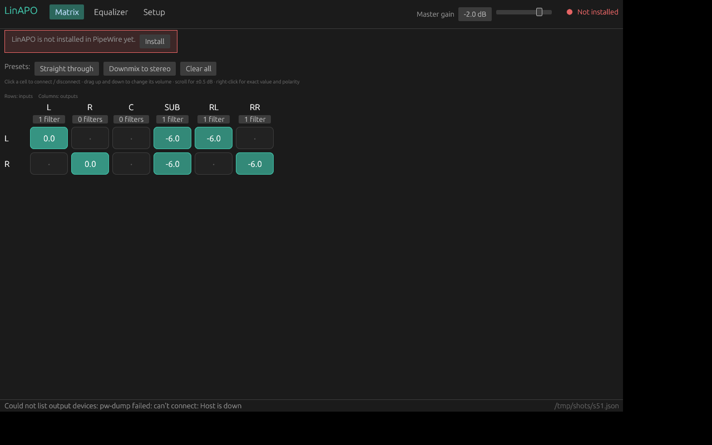
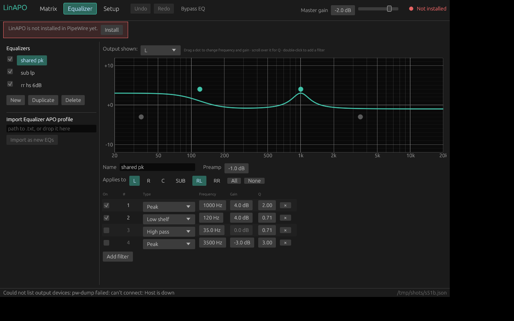
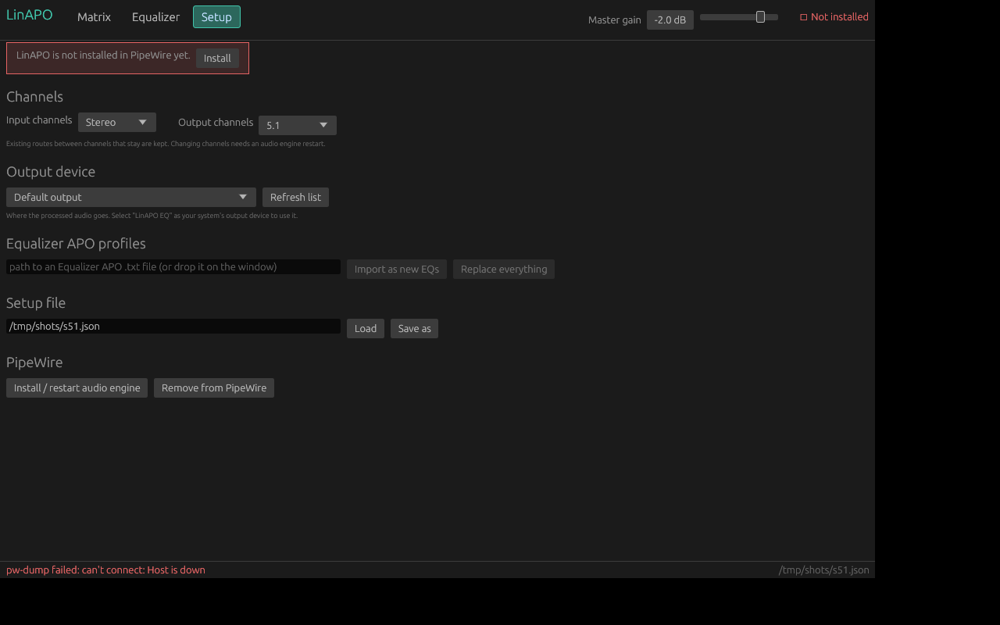
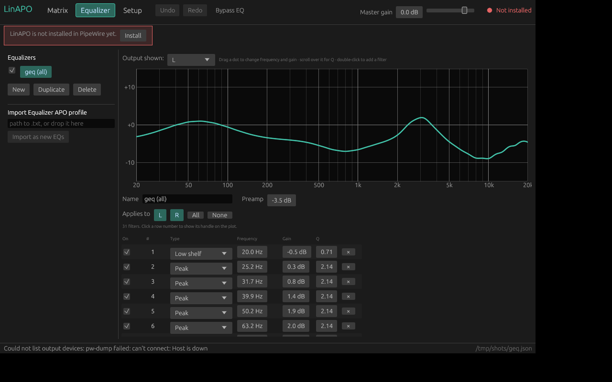

# linapo

Equalizer APO + Peace for Linux (PipeWire): a **channel matrix**, **per-channel EQs**,
a **master gain**, and **Equalizer APO profile import**.

```
inputs ──► matrix (N×M gains) ──► EQ per output channel ──► master gain ──► outputs
```

| Milestone | Status |
|---|---|
| 1. Biquad math + APO parser | done |
| 2. CLI → PipeWire virtual sink | done |
| 3. Channel matrix, per-channel EQ assignment, master gain, 5.1/7.1, live edits | done |
| 4. GUI (`linapo-gui`) | done (this release) |

## Quick start

```sh
cargo test --workspace                                  # 188 tests, no PipeWire needed
cargo build --release                                   # target/release/linapo  and  linapo-gui

linapo-gui                                              # the graphical editor (see below)

linapo setup import examples/sample.txt -o my.json      # APO profile -> setup file
linapo info my.json                                     # matrix, EQs, channels
linapo install my.json                                  # virtual sink + restart PipeWire
linapo live master my.json -6                           # change master gain, no restart
linapo live route my.json L SUB -3                      # change one matrix cell, no restart
linapo live apply my.json                               # push every value of an edited my.json
linapo uninstall
```

After `install`, choose **LinAPO EQ** as the output device in your sound settings (or
`wpctl set-default`). Audio goes: apps → LinAPO EQ → your default output. Use
`--target <node.name>` to send it to a specific device.
`install` restarts `pipewire`, `wireplumber` and `pipewire-pulse`, which briefly interrupts
audio; use `--no-restart` to skip.

Other commands: `linapo process setup.json in.wav out.wav` (render a WAV offline through the
full engine), `linapo response setup.json -c L` (frequency response CSV),
`linapo gen-config` (print the PipeWire config), `linapo setup new --layout stereo --out-layout 5.1`.
Every command that takes a setup also accepts an Equalizer APO `.txt` directly (`--layout 5.1`).

## The GUI

```sh
cargo run --release -p linapo-gui          # or: linapo-gui [path/to/setup.json]
```

The setup lives in `~/.config/linapo/setup.json` and is saved automatically; every edit is
pushed to PipeWire within about 60 ms, with no restart. Drop an Equalizer APO `.txt` (or a setup
`.json`) on the window to import it. `packaging/linapo.desktop` is a starter menu entry.

**Matrix**: click a cell to connect or disconnect, drag it up and down to change the volume,
scroll for ±0.5 dB, right-click for an exact value and polarity inversion. The `n filters`
button under each output jumps to that output's equalizer. Presets: straight through, downmix to
stereo, clear.



**Equalizer**: a list of EQs on the left (enable, duplicate, delete, import APO profiles); for
the selected EQ a response plot with one draggable dot per filter, plus name, preamp, the output
channels it applies to, and a table of filters. Drag a dot to change frequency and gain, scroll
over it to change Q, double-click empty space to add a filter. The white curve is the combined
response of every EQ on the output channel you choose; the teal one is the selected EQ alone.



**Setup**: input and output channel layouts (existing routes between channels that stay are
kept), the output device, APO import (as new EQs, or replace everything including `Copy:`
lines), and install / remove.



**Files**: *Browse...* (import an APO profile), *Browse and replace...*, *Open...* and *Save a copy...*
open native file dialogs that remember the last folder; dropping a file on the window still works.
**Delete** removes the selected filter.

**Top bar**: *Undo* / *Redo* (Ctrl+Z, Ctrl+Shift+Z; a whole drag is one step, and every edit
is undoable, including imports and layout changes), *Bypass EQ* for A/B comparison with the
original sound, and the master gain. Each filter has an *On* checkbox; disabled filters are
grey dots on the plot and drop out of the curve. A status pill (top right) shows whether the audio engine is **Live**, **Not installed**, **Not
running** or needs a **restart**. Changing channels, the output device, or the number/type of
filters is structural: a banner offers "Apply and restart audio" (which restarts PipeWire and
briefly interrupts sound). Everything else is live.

Built with egui/eframe: pure Rust, no GTK or Qt needed. PipeWire work runs on a background
thread, so the window never blocks, and bursts of edits are coalesced.

## The setup file

```json
{
  "input_channels":  ["L", "R"],
  "output_channels": ["L", "R", "C", "SUB", "RL", "RR"],
  "matrix": [[1,0,0,0.5,0.5,0],
             [0,1,0,0.5,0,0.5]],
  "eqs": [
    { "name": "sub lp", "channels": ["SUB"],
      "filters": [{ "kind": "low_pass", "fc_hz": 500, "q": 0.7071 }] },
    { "name": "shared", "channels": ["L", "RL"], "preamp_db": -1,
      "filters": [{ "kind": "peaking", "fc_hz": 1000, "gain_db": 4, "q": 2 }] }
  ],
  "master_gain_db": -2,
  "limiter": true
}
```

* **matrix** is `[input][output]` in *linear* gain: `0` = not routed, `1` = unity, `0.5` ≈ -6 dB,
  negative = polarity inversion. Any input can feed any output at any volume.
* **eqs**: each has a channel list (*output* channels). One EQ can serve many channels; a channel can
  have several EQs, which stack. `enabled: false` switches one off.
* Each filter has `"enabled": true/false` (a disabled filter keeps its settings and does nothing),
  and the setup has `"bypass_eq": true` to switch every EQ off at once for A/B comparison.
* Filter kinds: `peaking`, `low_shelf`, `high_shelf`, `low_shelf1`, `high_shelf1` (6 dB/oct),
  `low_pass`, `high_pass`, `band_pass`, `notch`, `all_pass`. `q` defaults to 0.7071.
* Channel names: `L R C SUB RL RR SL SR` (aliases FL FR FC LFE BL BR) and `CH1`, `CH2`...

## Equalizer APO import

`Preamp`, `Filter` (PK, LP/LPQ, HP/HPQ, BP, NO, AP, LS/LSC/LSQ, HS/HSC/HSQ, `LS 6dB` / `LS 12dB`,
`BW Oct`), `Channel:` (becomes EQ-to-channel assignment), `Copy:` (becomes the matrix, including
`0.5*L+0.5*R`, `-6dB*C`, simultaneous `Copy: L=R R=L`), `GraphicEQ:` (see below) and `Include:`.
`Device:`, `Delay:`, `Convolution:`, `If/Else`, VST/LADSPA warn and are ignored.

### GraphicEQ

Equalizer APO turns a `GraphicEQ:` line (many `frequency gain` points, as exported by AutoEq) into
a linear-phase FIR filter. linapo instead **fits a bank of ordinary filters** to the same curve (a
low shelf, peaking filters, a high shelf, plus a preamp), using least squares on the log-frequency
interpolation APO documents (linear in dB against log frequency, flat beyond the end points):

* No latency (an FIR would delay the sound by tens of milliseconds, which hurts lip-sync in video).
* They are normal filters: editable, switchable, live, and one `Channel:` section scopes them.
* It is a magnitude approximation, and the phase differs from APO's linear-phase FIR. The import
  tries 3, 4, 6, then 8 bands per octave and keeps the smallest bank within 0.5 dB; the result and
  its maximum error are shown on import. A smooth 127-point headphone-style curve became **31
  filters with a 0.26 dB maximum error**. Very sharp features (narrower than about a third of an
  octave) can exceed that, and the message will say so.
* I read APO's "flat outside the specified bands" as holding the end values. If APO actually
  returns to 0 dB there, results differ only beyond the first/last point (AutoEq's cover 20 Hz-20 kHz).


Files may be UTF-8 (BOM ok) or UTF-16; bad lines become warnings.

## Live editing

Everything numeric changes instantly while audio plays: matrix cells, preamps, master gain, and
the frequency / Q / gain of **every** filter type, plus switching a single filter or the whole EQ
on and off (`linapo live apply`, `master`, `route`, `bypass on|off`; the GUI does this for every
edit). Only the *structure* needs `linapo install`: channel layout, output device, and the number
or type of filters. `live apply` tells you when that is the case.

Under the hood, peaking and shelf filters use PipeWire's native nodes; every other kind is a
`bq_raw` node whose coefficients are computed here and pushed at the graph's running sample rate
(read from PipeWire's `settings` metadata). A disabled filter stays in the graph with neutral
values, which is why toggling never needs a restart. After each live edit the installed config
file is refreshed too, so a PipeWire restart starts from your current values.

## How it works, and what I verified

PipeWire's own `filter-chain` module runs the DSP (nodes: `copy`, `mixer`, `linear`, `bq_*`).
`linapo-core` also contains a complete reference engine (`engine.rs`) with smoothed matrix/gain
ramps, per-channel EQ state and a peak limiter; it powers `linapo process` and is the oracle the
PipeWire backend is tested against.

I ran everything against a real **PipeWire 1.0.5 + WirePlumber** (headless, null output):

* An imported 127-point GraphicEQ (31 biquads per channel) matched the engine to **0.005 dB**, so
  PipeWire's float32 biquad cascade is not a precision problem at that size.
* All 10 filter types, a stereo→5.1 upmix, per-route volumes, shared EQs and master gain match
  the engine to **0.000 dB** at every tone on every channel.
* Live edits made mid-playback landed within ~100 ms and matched the engine afterwards.
* `tests/pipewire/parity.py SETUP.json` repeats this on your machine with a *private* PipeWire
  (needs pipewire, wireplumber, pw-cat, dbus-run-session, numpy).
* The GUI was driven end to end: real mouse clicks (xdotool, under Xvfb) on the real binary, against
  a private PipeWire, while a tone played. Connecting a matrix cell moved a tone between channels
  within ~100 ms, and a slider drag reached exactly the saved dB value in the recorded audio
  (`tests/pipewire/gui_e2e/`; its click coordinates are calibrated to the default window size).

Things testing turned up, now handled:

* PipeWire 1.0.5's native `bq_lowpass`/`bq_highpass` do not treat Q like the RBJ cookbook
  (requested 0.7071 behaved like 0.90). They (and band-pass, notch, all-pass, 6 dB shelves) are
  emitted as `bq_raw` with exact coefficients instead: per sample rate in the config, and as live
  controls for the running rate. Verified by editing their parameters, disabling filters and
  switching bypass on during playback: output matched the engine to within 0.03 dB.
* `pw-cli set-param` silently drops a batch larger than ~1 KB, so `live` sends small chunks and
  checks that PipeWire echoed every key.

## Limitations

* Tested on PipeWire 1.0.5 only. Newer versions should behave the same; if not, run
  `tests/pipewire/parity.py`.
* The **limiter** exists only in the reference engine; the PipeWire backend ignores it (with a
  warning). Keep preamps conservative.
* At most **8 input channels** (the builtin mixer has 8 inputs).
* EQ always runs after the matrix; APO processes lines in file order, so profiles that filter
  *before* a `Copy:` can differ.
* `LSC x dB` slope forms and `LS 12dB` are close approximations of APO's definitions. I could
  not run Equalizer APO to compare.
* Changing a gain jumps rather than ramps on the PipeWire backend (the reference engine ramps).
* If your PipeWire switches sample rate at runtime (several `clock.allowed-rates`), live edits of
  the raw-coefficient filters are computed for the rate PipeWire reports by default; a mismatch
  corrects itself at the next change of that filter's structure or after a restart.
* File dialogs (Browse, Open, Save a copy) use the desktop's XDG portal, so they need
  `xdg-desktop-portal` plus a backend (GNOME, KDE, GTK... all ship one). Without one the app says so
  and you can paste a path or drop the file on the window instead. I saw the real GTK chooser open
  from the app; I did not test KDE's. The layout pickers offer mono, stereo, quad, 5.1 and 7.1; arbitrary channel
  lists work in the setup file but are not editable in the GUI.
* Not covered: a real `pw_filter` engine. `pipewire-rs` (0.8/0.9) has no filter bindings, and
  `filter-chain` already provides the virtual sink, linking and format handling.

## Layout

```
crates/linapo-core/   biquad.rs filter.rs apo.rs matrix.rs setup.rs chain.rs engine.rs handoff.rs pipewire_conf.rs
crates/linapo-pw/     PipeWire plumbing shared by CLI and GUI: install, live apply, status, device list
crates/linapo-cli/    the `linapo` binary + tests/cli.rs
crates/linapo-gui/    the egui app: model.rs (edit logic), plot_math.rs, backend.rs (worker), app.rs (UI), ui_tests.rs
tests/pipewire/       parity.py (audio parity), gui_e2e/ (GUI against a private PipeWire)
examples/             sample.txt (APO profile), stereo-to-5.1.json (setup)
packaging/            linapo.desktop
docs/                 screenshots
```
`handoff.rs` is a lock-free hand-over for swapping in a new engine on a real-time thread,
for a future custom node or GUI engine.
